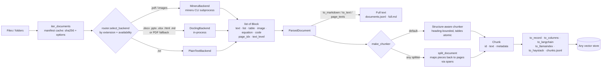

# doc2rag

Turn PDFs, Office files, images and text into **full text** and **vector-store-ready chunks**, in one line, for any RAG stack.

- **No required dependencies.** Parsers are optional extras: [MinerU](https://github.com/opendatalab/MinerU) for high-quality PDF/scan parsing, [Docling](https://github.com/docling-project/docling) for PDF, DOCX, PPTX, XLSX, HTML and images.
- **Full text before chunking** (Markdown or plain text, whole document or per page), so you can use your own splitter or LLM.
- **Structure-aware chunks**: chunks never cross a heading, tables/equations stay whole, and every chunk records its pages and section path.
- **Works with any RAG pipeline**: plain dicts, Chroma-style columns, LangChain, LlamaIndex, Haystack, or any `str -> list[str]` splitter.
- **Incremental**: unchanged files are served from cache, and chunk IDs are deterministic, so re-runs upsert cleanly.

## Install

```bash
pip install "doc2rag[docling]"          # Office + PDF, CPU-friendly
pip install "doc2rag[mineru]"           # best PDF/scan quality (Python 3.10-3.13)
pip install "doc2rag[all]"              # both
# from source: pip install "./doc2rag[docling]"
```

Or without installing anything locally (Docker):

```bash
docker build -t doc2rag --build-arg EXTRAS=docling .
docker run --rm -v "$PWD/data:/data" doc2rag /data/in -o /data/out
```

## Use

```python
import doc2rag

# 1. Full text, before chunking
text  = doc2rag.extract_text("contract.pdf")                 # Markdown
plain = doc2rag.extract_text("contract.pdf", fmt="text", page_breaks=True)

doc = doc2rag.parse("contract.pdf")                          # ParsedDocument
doc.to_markdown(); doc.to_text(); doc.page_texts()           # {1: "...", 2: "..."}
doc.blocks                                                   # typed blocks (text/table/image/...)

# 2. Chunks ready to embed
chunks  = doc2rag.load("contracts/")                         # list[Chunk]
records = doc2rag.load_records("contracts/", extra_metadata={"tenant": "acme"})
# -> [{"id": "...", "text": "...", "metadata": {"source", "pages", "page_start", "section", ...}}]
```

### Plug into your RAG stack

```python
# Any vector store (OpenAI embeddings shown)
for batch in doc2rag.batched(doc2rag.load_records("docs/"), 64):
    vectors = client.embeddings.create(model="text-embedding-3-small", input=[r["text"] for r in batch])
    store.upsert([(r["id"], v.embedding, r["metadata"]) for r, v in zip(batch, vectors.data)])

# Chroma
collection.add(**doc2rag.to_columns(doc2rag.load("docs/")))   # ids / documents / metadatas

# LangChain
docs = doc2rag.Doc2RagLoader("docs/").load()                  # list[langchain Document]
docs = doc2rag.to_langchain(doc2rag.load("docs/"))

# LlamaIndex
index = VectorStoreIndex(doc2rag.to_llamaindex(doc2rag.load("docs/")))

# Haystack
document_store.write_documents(doc2rag.to_haystack(doc2rag.load("docs/")))
```

### Bring your own chunker

The page and section metadata is kept whichever chunker you use.

```python
doc2rag.load("docs/", chunk_size=800, overlap=100)                  # built-in
doc2rag.load("docs/", chunker=RecursiveCharacterTextSplitter(chunk_size=1000).split_text)
doc2rag.load("docs/", chunker=SentenceSplitter(chunk_size=512))     # anything with .split_text
doc2rag.load("docs/", chunker=lambda text: text.split("\n\n"))      # any str -> list[str]

def my_chunker(doc: doc2rag.ParsedDocument) -> list[doc2rag.Chunk]: ...
doc2rag.load("docs/", chunker=my_chunker)                          # full control over blocks
```

### CLI

```bash
doc2rag contracts/ -o out                        # full text + chunks
doc2rag contracts/ -o out --text-only            # full text only
doc2rag scan.pdf --print markdown --text-only    # print text to stdout
doc2rag contracts/ -m ocr -l en --chunk-size 1000 --overlap 150
doc2rag --list-backends
```

## Outputs

```
out/
  documents.jsonl          one line per document: doc_id, source, pages, text (full Markdown), metadata
  chunks.jsonl             one line per chunk: id, text, doc_id, source, pages, section, heading_path, ...
  errors.json              file -> error (a bad file never stops the batch)
  manifest.json            incremental cache (sha256 + options)
  documents/<name>_<hash>/
    full.md                full text with <!-- page N --> markers
    blocks.json            structured blocks (type, page_idx, text_level, table_html, img_path, ...)
    mineru/ | docling/     raw parser artifacts + extracted images
```

## Architecture



**Routing**: with `backend="auto"`, PDFs and images go to the first installed backend in `pdf_preference` (default `mineru`, then `docling`), and everything else goes to Docling. If you ask for a backend that can't read a file type (for example MinerU on a `.docx`), the file falls back to one that can. Legacy `.doc/.ppt/.xls` files must be saved as `.docx/.pptx/.xlsx` first.

**Custom backends**: subclass `doc2rag.Backend`, set `name` and `extensions`, implement `is_available()` and `parse()`, and decorate the class with `@doc2rag.register_backend`.

## Configuration

| Option (Python / CLI) | Default | Meaning |
|---|---|---|
| `backend` / `-b` | `auto` | `auto`, `mineru`, `docling`, `text` |
| `method` / `-m` | `auto` | `auto`, `txt` (text layer only), `ocr` (force OCR for scans) |
| `lang` / `-l` | none | MinerU OCR language (`en`, `latin`, `ch`, ...) |
| `mineru_backend` | `pipeline` | MinerU `-b`; `pipeline` is the CPU-friendly choice |
| `device` | auto | MinerU device (`cpu`, `cuda`) |
| `chunk_size` / `overlap` | 1500 / 200 | built-in chunker size in characters |
| `include_layout` | `False` | keep page headers/footers |
| `incremental` | `True` | skip unchanged files |
| `DOC2RAG_OUTPUT_DIR` | `./doc2rag_output` | default output directory |


## Data privacy

Parsing runs entirely locally: no document content is sent anywhere. Only the model weights are downloaded, once.

## Development

```bash
pip install -e ".[dev]"
pytest
```
